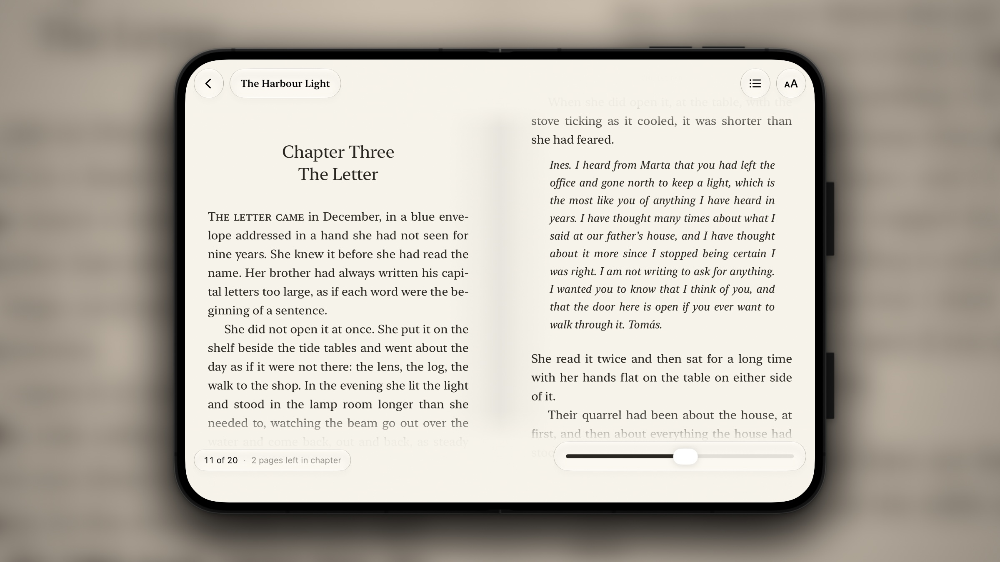
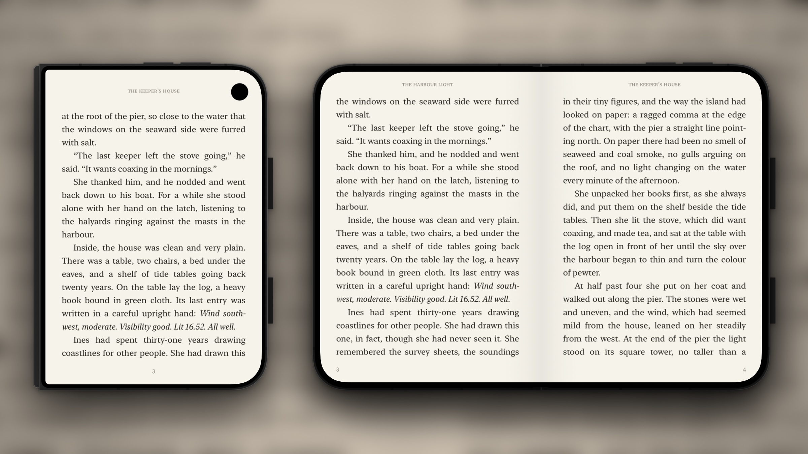
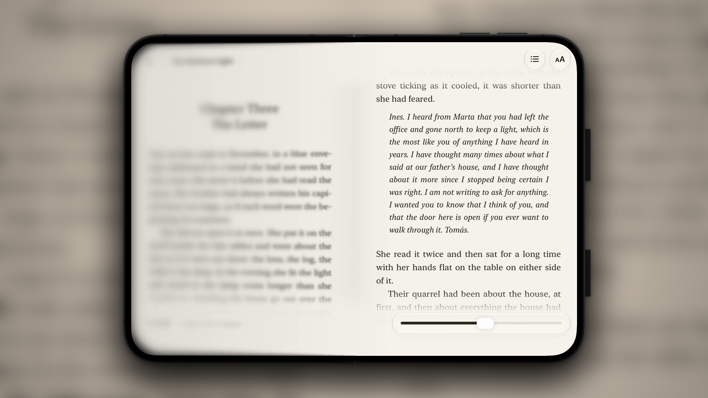
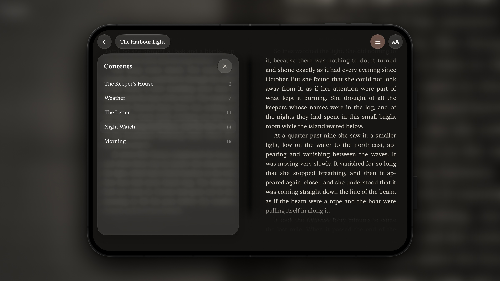
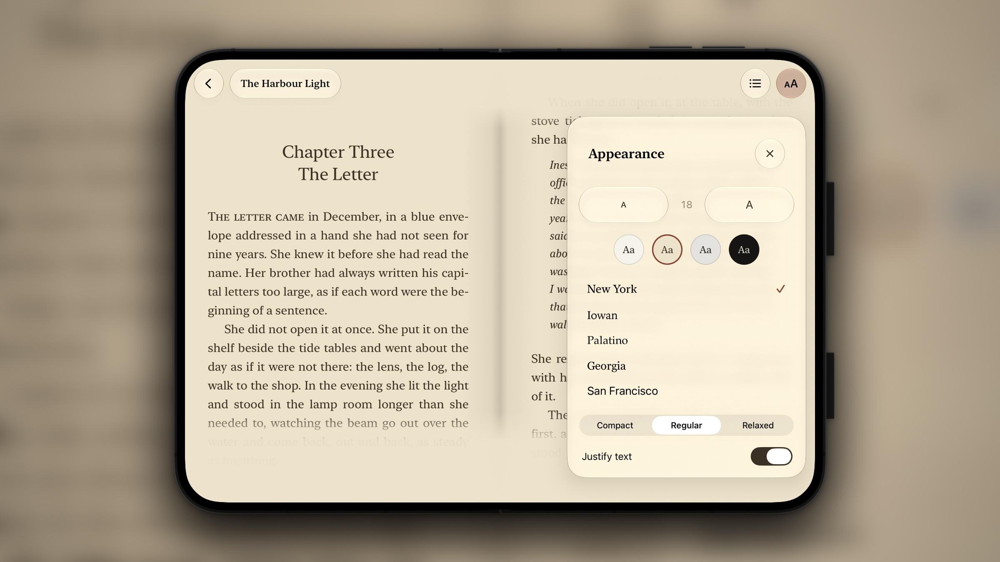

<p align="center">
  
</p>

<h1 align="center">Folio</h1>

<p align="center">
  An EPUB reader for the iPhone Duo. Open the phone and the book is set as two facing pages on either side of the fold. Close it and you keep reading the same page on the outer screen.
</p>

<p align="center">
  <a href="https://apps.apple.com/app/folio-ebook-reader/id6826603251">
    
  </a>
</p>

<p align="center">
  
</p>

## Features

- **A spread on the inner screen.** Two facing pages sit either side of the system's crease region, so no line of text falls on the fold.
- **A single page on the outer screen.** The controls move to the bottom of the screen, within reach of your thumb.
- **Your place carries over when you fold.** Open and closed pages are almost the same width, so lines break almost the same way on both screens.
- **Liquid Glass controls.** Contents, appearance and a page slider appear when you tap the middle of the page. On the open phone, no control crosses the fold.
- **Book typography.** Justified text with hyphenation, small caps at the start of each chapter and a running head on every page.
- **Four page colors and five typefaces.** Paper, Sepia, Stone and Night, set in New York, Iowan, Palatino, Georgia or San Francisco.
- **No dependencies.** Folio reads EPUB files with its own engine, and your books never leave the device.
- **Any iPhone or iPad.** Folio runs on iOS 26 and later, and wide screens get the two-page spread too.

## Screenshots

<table>
  <tr>
    <td width="50%"></td>
    <td width="50%"></td>
  </tr>
  <tr>
    <td align="center">The same page closed and open</td>
    <td align="center">Folding, with the blur iOS draws on the half that turns away</td>
  </tr>
  <tr>
    <td width="50%"></td>
    <td width="50%"></td>
  </tr>
  <tr>
    <td align="center">Contents on one page, the book on the other</td>
    <td align="center">Appearance settings in the Sepia theme</td>
  </tr>
</table>

## Getting started

### Requirements

- Xcode 27.1 or later.
- An iPhone or iPad with iOS 26 or later, or a simulator.
- For the iPhone Duo simulator, the iOS 27.1 simulator runtime. Download it from Xcode's settings, or run `xcodebuild -downloadPlatform iOS`.

### Build and run

```bash
git clone https://github.com/Larkooo/Folio.git
cd Folio
open Folio.xcodeproj
```

Choose the Folio scheme and a simulator, then run. To install on your own device, set your team under Signing & Capabilities. Folio has no packages to resolve.

To build from the command line:

```bash
xcodebuild -project Folio.xcodeproj -scheme Folio -destination 'platform=iOS Simulator,name=iPhone Duo' build
```

### Add books

Folio opens EPUB files without DRM. Tap **+** in the library to choose files from Files, or open an EPUB from another app with Folio. A short sample book is included so the library is not empty on first launch.

On a simulator, you can send a book straight to the app:

```bash
xcrun simctl openurl booted "file:///path/to/book.epub"
```

[Standard Ebooks](https://standardebooks.org) and [Project Gutenberg](https://www.gutenberg.org) have thousands of free public-domain books. Books bought from Kindle or Apple Books are protected with DRM and will not open.

## How Folio handles the fold

The iPhone Duo APIs arrived in iOS 27.1. Folio targets iOS 26, so each one sits behind an availability check.

- **The crease.** `FoldLayout` asks for `GeometryProxy.reservedRegions(kind: .division)` and lays the two pages out on either side of it. On the Duo the region is 40 pt wide at the center of the inner screen. Wide screens without a fold split down the middle instead.
- **The hinge.** `HingeReader` listens with `onHingeChange` and passes the hinge angle down through the environment. The shadow along the binding deepens a little as the phone folds.
- **The vertical status bar.** The Duo shows its status bar down one side of the screen. While a book is open, `RootHostingController` returns `.disabled` from `preferredVerticalBarBehavior`, which moves the status bar back to the top and gives the closed page the full width of the outer screen. SwiftUI has no modifier for this yet, so the app starts from a small UIKit scene delegate that hosts the SwiftUI views.
- **Keeping your place.** A reading position is a chapter and a character offset rather than a page number. After every layout change, Folio finds the page that holds that offset.

## Testing without an iPhone Duo

If you do not have the iOS 27.1 runtime, Folio can draw a simulated Duo inside an iPad simulator. Both of the Duo's screen sizes fit on a 13-inch iPad at full size, and the harness has buttons to open, half-open and close the phone.

```bash
SIMCTL_CHILD_FOLIO_DUO=1 SIMCTL_CHILD_FOLIO_POSTURE=open \
  xcrun simctl launch --terminate-running-process booted com.nsrdm.folio
```

<details>
<summary>All debug launch flags</summary>

Pass these to `simctl launch` with a `SIMCTL_CHILD_` prefix. They only work in Debug builds.

| Flag | Effect |
| --- | --- |
| `FOLIO_DUO=1` | Render inside a simulated Duo |
| `FOLIO_POSTURE=open\|half\|closed` | Starting posture for the simulated Duo |
| `FOLIO_OPEN=1` | Open the most recent book at launch |
| `FOLIO_PAGE=n` | Jump to page n (counting from zero) |
| `FOLIO_CHROME=1` | Show the reader controls at launch |
| `FOLIO_PANEL=contents\|appearance` | Open a panel at launch |
| `FOLIO_THEME=paper\|sepia\|stone\|night` | Use a theme for this launch only |
| `FOLIO_PROBE=1` | Print the screen size, safe area and reserved regions (use `simctl launch --console-pty`) |

</details>

## Project layout

| Folder | What it holds |
| --- | --- |
| `Folio/Book` | The EPUB engine: ZIP reading, XHTML parsing, typesetting and TextKit pagination |
| `Folio/Reader` | The reader screen, page turning, the Liquid Glass controls and panels, and settings |
| `Folio/Library` | The library store and screens. Each book lives in its own folder in Application Support |
| `Folio/Device` | Fold handling and the simulated Duo used for testing |
| `Folio/App` | The UIKit entry point that hosts the SwiftUI app |
| `tools` | The script that builds the bundled sample book |
| `marketing` | The script that frames simulator captures in the Duo artwork from Xcode |

## License

Folio is free software: you can redistribute it and modify it under the terms of the GNU Affero General Public License, version 3, as published by the Free Software Foundation. See [LICENSE](LICENSE) for the full text.

Copyright (C) 2026 Larkooo

## Contributing

Issues and pull requests are welcome. By submitting a contribution, you agree that it is licensed under the AGPL-3.0 and that the project owner may also distribute it under other license terms, including in versions of Folio sold on the App Store.
